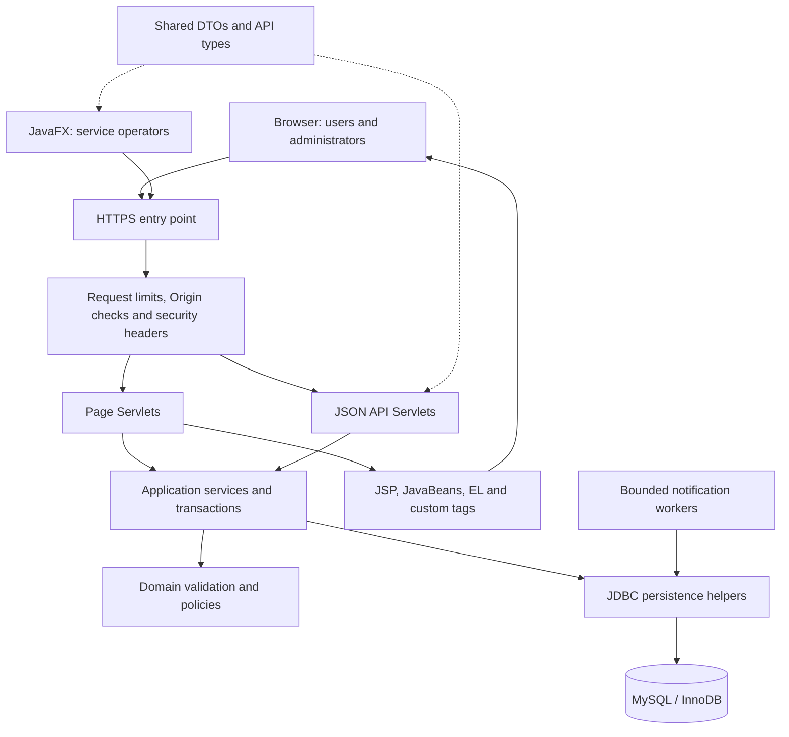
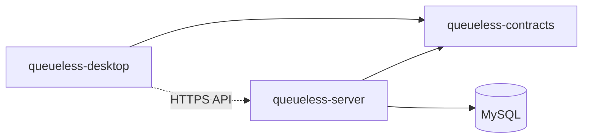
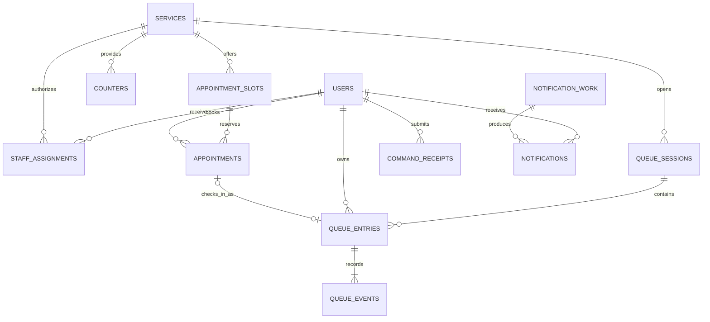

# QueueLess architecture

This document records the approved design and its correctness rules. It is not evidence that a feature has been implemented or verified. The implementation and verification status is tracked separately in `milestones.md` and `syllabus-coverage.md`.

## Product boundary

QueueLess is a single-organization queue and appointment management application. The default organization timezone is `Asia/Kolkata`. Users access a browser application; staff operate assigned service counters through JavaFX; administrators manage services, calendars, staff assignments and reports through the browser.

The complete product includes registration and sessions, service directories and working hours, walk-in tokens, appointment booking/cancellation/check-in, multiple counters, controlled queue transitions and requeueing, periodically refreshed status and estimates, a persistent notification inbox, history/audit records, reports/CSV, safe local preference serialization, and online deployment.

External email/SMS/push delivery, commercial multi-tenancy, billing, arbitrary workflow builders and VIP priority rules are outside this product boundary. Their omission follows product need and complexity, not a development deadline. Future commercial use is supported by explicit contracts, authorization and durable data; the current design does not claim tenant isolation or production-scale operating experience.

## Integrated architecture



The normal browser flow is **browser -> Servlet -> service -> JDBC -> MySQL -> Servlet -> JSP -> browser**. JSP is a presentation layer and does not execute SQL. JavaFX sends HTTP locally and HTTPS online to the same authoritative backend. Only the backend possesses database credentials or accesses production MySQL.

Servlets parse input and map results/errors; services own use cases and transaction boundaries; domain components enforce transition and selection rules; the Sql persistence helper executes prepared SQL and maps rows on the caller-owned connection. Page controllers and JSON controllers call the same services. JSON transport types are explicit DTOs, not serialized server entities. The shared module contains no JDBC, JavaFX or Servlet dependencies.

## Repository and dependencies

```text
pom.xml
queueless-contracts/       Request/response DTOs and shared transport types
queueless-server/          WAR; Servlets, JSP, services, domain rules, JDBC and workers
queueless-desktop/         JavaFX application and HTTP client
docs/                      Architecture, syllabus evidence and verification checklists
```



The desktop does not depend on the server Maven artifact. There are no circular dependencies. A Maven multi-module build is separate from Java Platform Module System descriptors; do not introduce JPMS complexity solely because Maven uses modules.

The selected technology family is Java 21, JavaFX 21, Tomcat 10.1 with Jakarta Servlet 6.0 / Pages 3.1, a compatible Jakarta Tags implementation, MySQL 8.4/InnoDB and Connector/J. Exact dependency patches are pinned and validated in the build. Use `jakarta.servlet.*`; JDBC remains `java.sql`/`javax.sql`. Spring Boot and an ORM must not hide the required Servlet/JSP/JDBC implementations.

## Domain and state rules

### Daily sessions and active visits

- Each service has a daily queue session and monotonically allocated scoped token numbers.
- At most one unresolved visit per user/service exists across dates. Unresolved states are `WAITING`, `CALLED`, `SERVING` and recoverable `SKIPPED`.
- A future `BOOKED` appointment is independent of an unresolved queue visit. Check-in creates or links its one queue visit atomically and must satisfy active-visit uniqueness.
- Non-cancelled future appointment windows for one user must not overlap, including bookings at different services. Adjacent half-open windows `[start, end)` do not overlap.
- Midnight does not delete, reset or silently resolve earlier work. Admission and day-close rules preserve unresolved visits and their histories.
- Positions and estimated waits are derived observations. Token number is an identity within a session, not a mutable queue position.

### Queue state machine

The ordinary path is `WAITING -> CALLED -> SERVING -> COMPLETED`.

`CALLED -> SKIPPED` records absence and preserves an unresolved visit. An authorized return changes `SKIPPED -> WAITING`, allocates a fresh ready sequence and places it at the walk-in tail. A returned visit retains its identity/history and cannot recover its former rank. Recall is an event while remaining `CALLED`.

Cancellation, no-show and abort are terminal outcomes where permitted. `ABORTED` distinguishes interrupted service from completion. The service layer checks allowed source state, actor, assignment, counter ownership/version and expected entry version. It never accepts an arbitrary client-provided destination state. Final action permissions, grace periods and check-in/cancellation windows must be explicit configuration with boundary tests.

### Appointments and capacity

Appointment states are `BOOKED`, `CHECKED_IN`, `FULFILLED`, `CANCELLED`, `NO_SHOW` and `ABORTED`. Check-in and queue-entry creation/linking occur in one transaction. A unique appointment-to-visit relationship makes repeated check-in harmless. Completion or terminal failure updates both linked records consistently.

Every slot has a hard reservation limit `K`. Retained reservations are independent of advisory planned counter-minutes and the actual number of open/vacant counters. Only cancellation or rescheduling while the appointment is still `BOOKED` releases its reservation. Check-in consumes the reserved arrival place: subsequent linked-visit cancellation, fulfillment, no-show or abort retains that place and does not reopen the old slot. Decreasing capacity must not invalidate retained reservations. Rescheduling a `BOOKED` appointment is atomic release plus acquisition, with rollback retaining the original booking if the target is unavailable.

Appointment availability combines calendar validity, booking/check-in windows and hard reservation capacity. Counter availability affects service readiness and estimates; it is not a second interpretation of slot reservation capacity. Changes to working hours or staffing must handle existing reservations explicitly rather than erase them.

### Counter ownership and simultaneous operators

Services have multiple counters. Staff require an active service assignment and an explicit durable counter claim tied to their authenticated session. Every claim has a version used to fence stale clients. There is no timed counter lease.

A counter may be released only while empty. Authorized takeover changes ownership/version and preserves an occupied counter and its current entry. Logout, session expiry or a disconnected computer must not implicitly complete, lose or reassign the occupied visit. Later operations from the old claim/session are rejected. At most one entry is `CALLED` or `SERVING` at a counter, and an entry cannot occupy two counters.

### Queue selection and fairness

The product supports FIFO and an appointment-aware policy. The appointment-aware policy is the default; neither policy permits arbitrary VIP promotion.

- Eligible appointment entries (`A`) are checked in and due, ordered by appointment window start then ready sequence.
- Walk-in entries (`W`), including returned skipped visits, are ordered by ready sequence.
- Each service stores a persistent appointment dispatch streak `s` between 0 and 2.
- If `W` exists and `s == 2`, select `W`. Otherwise select `A` if one exists, else `W` if one exists.
- Dispatching `A` increments `s`, capped at 2, even when no `W` exists. Dispatching `W` resets `s` to 0.
- Count committed dispatches. A cancellation after dispatch does not refund the fairness turn.
- All counters serialize selection against the same service state. A per-client or per-counter streak would violate service-wide fairness.

FIFO orders eligible entries by ready sequence. Policy changes and exceptional operator actions are audited. Due appointments can change a displayed relative position, so the UI must explain that positions and estimates are snapshots, not guaranteed service times.

## Data model responsibilities

Physical table names may evolve during implementation; constraints and relationships below are required.

| Record | Purpose and integrity requirements |
| --- | --- |
| User/account | Canonical unique login, password hash, role, active state and timestamps |
| Service/calendar | Directory details, timezone-aware availability, policy and audited configuration |
| Staff assignment | Unique user/service membership; authorization checked server-side |
| Counter/claim | Service association, durable session owner and claim version; occupied entry preserved on takeover |
| Queue session | Unique service/business-date scope, admission state, token sequence and revision |
| Queue entry | User/service/session, token, origin/appointment link, ready sequence, state/version and lifecycle timestamps |
| Unresolved membership | Cross-date uniqueness for each user/service until the visit reaches a terminal state |
| Queue event | Append-only accepted action, actor, timestamp, entry version, reason and state before/after |
| Appointment slot | Service/window and hard capacity `K`; retained reservation accounting |
| Appointment | User/slot/window, lifecycle state, version and unique linked visit |
| Appointment event | Auditable booking, rescheduling, check-in and terminal outcome |
| Command receipt | Unique `(actor_id, request_id)`, operation fingerprint and committed result |
| Notification work | Durable inbox work created atomically with the triggering business event |
| Notification | Recipient-owned item, unique source/recipient identity and read state |
| Administrative audit | Actor, action, target, time and limited non-secret change details |



The diagram is conceptual, not executable DDL. Enforce foreign keys, scoped token uniqueness, appointment-to-visit uniqueness, unresolved membership uniqueness and counter occupancy constraints in MySQL as well as in services. Index actual queries such as eligible selection, user history, slot reservations and pending work. Preserve historical records when accounts/services are deactivated. Do not persist queue position or ETA as authoritative state.

## Transactions, retries and concurrency

Business correctness comes from MySQL transactions, constraints and row locks. Java synchronization coordinates threads within one JVM; it cannot protect data across server instances.

Each modifying use case owns one connection and one transaction. Participating JDBC helpers use that same connection and do not commit independently. Use a documented global ordering for the designated user/service root locks and then child rows. Re-read and validate protected state after acquiring locks. Keep transactions short; no network wait or file export occurs while holding business locks. Explicit isolation and tests must match the locking/query model; `READ COMMITTED` is the intended operating model for locked mutations.

### Idempotent command protocol

1. Authenticate and authorize the caller; determine and lock the required root rows in the global order.
2. Perform a **plain insert** into the command-receipt table under unique `(actor_id, request_id)` before domain mutation. The database arbitrates a key that did not previously exist; a lookup alone cannot lock absence reliably.
3. Validate current business state and apply the operation, events and notification work.
4. Mark the receipt `DONE` with its fingerprint/result and commit all records together. A `PENDING` receipt must never be committed.
5. If receipt insertion loses to a duplicate, roll back the entire losing transaction. Start a fresh read, compare the request fingerprint, and replay the original committed result only for the same actor/key/payload. A different payload using the key is a conflict.
6. Bounded deadlock/lock-failure retries repeat the whole transaction with the **same request key**. Rejected commands roll back their receipt rather than leaving a success claim.

A lost HTTP response cannot create a second token, booking, check-in or dispatch. Replays return the original accepted operation identity; they never restore an old domain state. Current authorization still applies to disclosure of the result.

### Required contested operations

| Competition | Required safeguard |
| --- | --- |
| Concurrent token requests | Lock service/session roots, validate active membership/capacity, allocate sequence, insert entry/event/receipt atomically; uniqueness is a final guard |
| Final appointment place | Lock slot and relevant roots; count/update retained reservations under the lock; enforce user overlap rules across services |
| Conflicting staff actions | Validate claim/session/version, lock the entry/counter, compare expected entry version and permitted state; only one result commits |
| User cancel versus Call Next | The same protected service/entry state and legal-transition checks determine one valid outcome |
| Timeout retry | Receipt protocol above; retain the same request key and fingerprint |
| Stale desktop | Versioned commands, current claim version and monotonically ordered snapshots; obsolete UI responses cannot authorize changes |
| Two workers | Lock one durable work row, insert uniquely identified notification(s), mark work done and commit atomically |

Tests must release competing HTTP requests through a barrier and inspect final MySQL rows, receipts and event histories as well as responses. Include failure after a partial SQL update to prove rollback. Avoid interpreting successful single-thread tests as concurrency evidence.

## Durable in-application notifications

Business transactions insert notification work. A bounded Java worker pool processes this DB-only work: lock a work row, insert recipient notification records under unique source/recipient keys, mark the work done, and commit once. On a crash before commit, none of the effects persist; after commit, uniqueness prevents duplicate items. There is no external delivery call and no work lease in this design.

An in-memory `BlockingQueue` carries wake-up hints and demonstrates producer/consumer communication. It is not the durable backlog. A periodic database scanner recovers work if hints are lost or the application restarts. A worker must not hold an open transaction while waiting on the hint queue. Log failures safely, use bounded retries, and shut down executors explicitly.

## Browser and desktop behavior

Use server-rendered JSP pages for user and administrator forms, history and reports. JavaBeans, EL, standard tags and a real reusable custom JSP tag provide presentation reuse. Escape untrusted output for its context; plain EL is not a universal escaping mechanism.

The browser workspace uses separate server-rendered pages at `/app?serviceId=<id>&view=<view>`. `overview`, `visits`, `appointments` and `notifications` are distinct destinations; staff/admin also have `counters` and `reports`, and only administrators have `administration`. `BrowserServlet` validates the view allowlist and authorizes direct page requests before rendering. A missing view selects Overview; an invalid view returns 404. `dashboard.jsp` supplies the shared navigation and includes only the selected workspace partial, rather than rendering all sections in one scrolling document.

Navigation and service selection retain the current service or page as appropriate. Overview summarizes active visits and appointments for the selected service: ordinary users see their own records, while operators see service-wide counts with corresponding labels. The notification inbox belongs to the signed-in account across services. Commands return to the relevant page with their existing feedback and retry safeguards; check-in opens Queue & visits. History/report return links preserve their originating workspace and service. Idle refresh reloads the current page, and JavaScript translates recognized legacy fragment bookmarks to the corresponding view URL. Administration-only member/audit queries run only for that page.

Overview is a compact summary with three counts and links. It does not repeat the service description, admission rules, working hours, tokens or queue forms. Queue & visits owns walk-in admission, service details/hours and the visit table/history. A labeled GET service picker replaces the repeated directory cards across service-specific pages and preserves the selected view without requiring JavaScript. Notifications has no service picker because its inbox spans services. Working hours are loaded for the visits, appointments and administration pages only.

JavaFX provides staff login, assigned-service/counter selection, queue views, call/recall/start/complete/skip/return actions, appointment visibility, notifications and report/export controls. HTTP runs in `Task<T>`/bounded background execution, never on the FX application thread. At most one refresh per active view is outstanding; results from a prior login, counter or service selection are ignored. Show last-update time and transport errors. Logout cancels protected work and clears in-memory credentials/cookies.

Polling and post-command refresh use snapshots with server time and revisions. Obtain related counts/status values consistently. Estimated wait is explicitly approximate and accounts for eligible work, active counters and observed duration; display its sample threshold and assumptions, and N/A when no meaningful estimate exists. Configured planning duration is not measured wait-time evidence.

## Security and API contract

- Server-managed sessions serve both clients. Rotate session identity on login, expire/invalidate sessions, protect cookies online, and retain desktop cookies/tokens only in memory.
- Public registration creates an ordinary user. Check active account, role, service assignment, resource ownership and counter claim on every protected operation.
- Require CSRF protection for cookie-authenticated mutations. GET requests do not mutate state.
- Use a maintained password hashing implementation or a reviewed JDK PBKDF2 configuration with per-password salts and stored work-factor metadata. Do not implement cryptographic primitives.
- JDBC values use prepared statements; dynamic identifiers/sort fields use allowlists. Secrets stay in server configuration and never enter the desktop artifact, repository or logs.
- API errors use a stable JSON envelope with a safe code/message and correlation identifier. Typical statuses are `400` invalid input, `401` unauthenticated, `403` forbidden, `404` unavailable resource, `409` conflicting/stale state and `500` unexpected failure. Do not return stack traces or SQL.
- Native object serialization is only for versioned non-sensitive local preferences. Restrict deserialization classes, depth/size and fields; recover safely from invalid input. JSON is the network format; native serialized objects are never accepted over the API.
- Reports and inbox items enforce ownership/scope like mutations. CSV output quotes fields correctly and handles spreadsheet-formula interpretation safely.

## Deployment and recovery

Local operation uses configurable base URLs and database settings, a Tomcat WAR, MySQL and the JavaFX client. Online operation uses one HTTPS endpoint/reverse proxy in front of Tomcat, with MySQL private to the backend network. One server instance is sufficient initially; data-integrity rules must not depend on JVM-local locks.

Use a finite connection pool, connection/query/HTTP timeouts, persistent database storage, rotated logs, restricted database accounts and an actual tested backup/restore procedure. Reboot/redeploy may require reauthentication but must preserve business records and counter/visit integrity. The user has deferred hosting selection and public deployment. The current delivery is the deployable package and documented local setup/recovery; the HTTPS deployment checklist remains a later acceptance gate.

## Implemented policy values

These are the current source values; verification evidence remains in `verification.md`.

| Rule | Implemented value |
| --- | --- |
| Booking horizon | Administrators explicitly publish future slots. There is no extra rolling-day horizon; only published, calendar-valid windows with spare quota can be booked. Each window lasts at most four hours. Booking closes at its start. |
| Cancellation and rescheduling | A BOOKED appointment can be cancelled or moved to another future slot of the same service. There is no cancellation fee or extra cutoff. Once checked in, visit transition rules apply. |
| Check-in | From ten minutes before the start through ten minutes after the end, inclusive. Explicit disruption protection removes the upper bound and automatic booking expiry; it does not permit early arrival before the lower bound. |
| No-show and return | Unprotected BOOKED appointments expire after the check-in upper bound. A skipped visit may return once, strictly before its fifteen-minute deadline, subject to walk-in capacity. Expiry processing runs periodically, so it is not an exact-time delivery guarantee. |
| Admission cutoff | Walk-ins require admission enabled, matching weekday hours with opening inclusive/closing exclusive, no dated closure, and remaining active walk-in capacity. Existing unresolved visits survive date rollover. |
| Visit cancellation | Customers can cancel WAITING/SKIPPED visits; staff may also cancel CALLED visits. SERVING work ends as COMPLETED or ABORTED, not cancellation. |
| Sessions and refresh | Thirty-minute session inactivity timeout. Browser refresh every fifteen seconds while idle; edits or uncertain requests prevent refresh. Desktop refresh defaults to five seconds, adjustable from three to sixty seconds. |
| Notification scan | Five-second worker scan plus bounded in-memory wake-up hints. Appointment reminders become eligible one hour before the window; notification persistence is database-transactional. |
| Reports | Default today plus the previous twenty-nine local dates. Selected date endpoints are inclusive; the upper date cannot exceed the lower date plus one calendar year. Completion/cancellation/no-show totals use finished timestamps; wait and service means use completed visits only. Appointment totals use window start dates and include all outcomes. Fulfilled totals require FULFILLED state. |
| Activity matrix | Counts completed visits by their service-start weekday/hour in Asia/Kolkata and the chosen start-date range. Its basis differs intentionally from completion-date report totals. |
| Recovery and intervention | Explicit counter resume or reasoned administrator takeover changes the ownership version and preserves occupied work. Client retry keeps the original actor, request ID and input; server retries at most three whole transactions. Connection/query/client limits are documented in `deployment.md`. |

Any later change to these rules requires corresponding service, test and demonstration updates, and a new migration when the schema changes.
